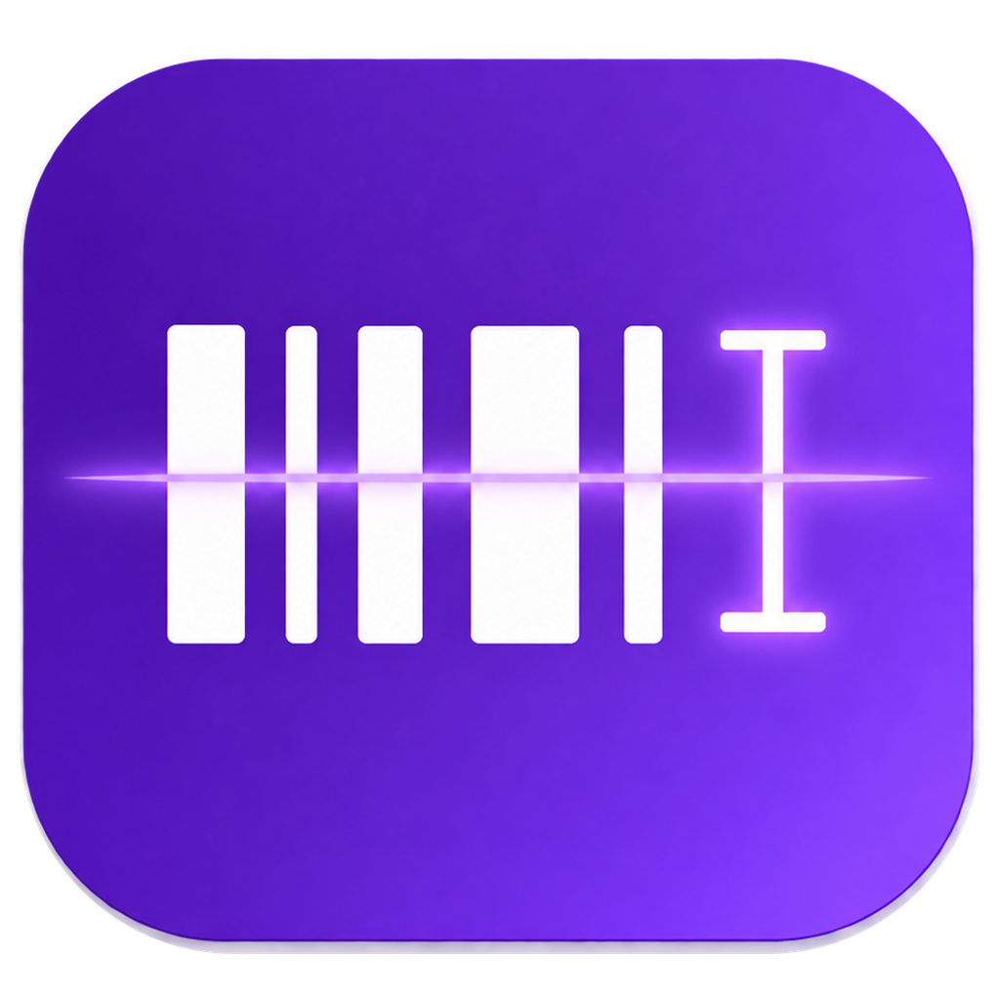

<p align="center">
  
</p>

<h1 align="center">Scan & Fill</h1>

<p align="center">
  Scan a utility bill barcode. The payment form fills itself.<br>
  A native Windows desktop app written in Rust with GPUI.
</p>

<p align="center">

[](https://github.com/aeonroamer/scan-and-fill/actions/workflows/ci.yml)

</p>

---

## The problem

Retail shops in Pakistan collect utility bill payments through portals such as NADRA's **e-Sahulat**. For every bill, the operator types a 14-digit reference number, tabs through the form, enters a contact number and confirms. On a busy day that is hundreds of bills, typed by hand, with typos that cost real money.

Every bill already carries a barcode with the reference, the amount, the due dates and the late-payment amounts. Scan & Fill reads that barcode and types the form for the operator.

## Features

- **Single mode:** scan a bill while the portal is focused, and the reference, contact number and every Tab and confirm keystroke are typed for you.
- **Paying for:** on portals that ask for a utility and company, the operator picks it once ("Electricity · MEPCO") on the Single or Bulk page. Nothing is inferred from the barcode, and Start stays locked until a company is chosen.
- **Bulk mode:** scan a stack of bills into a session first, then type them with a single trigger key (an arrow key, Shift, Ctrl or Alt). On portals with a multi-row form, one press can fill many rows at once.
- **Portal profiles:** every portal gets its own profile, so the app adapts to it instead of the operator adapting to the app. A profile holds the window to watch, the keystrokes for the form, the dropdown keys for each utility and company (the operator picks which company a run is paying), its typing speed, how many bills one press may fill, and a hint telling the operator where to place the cursor before starting.
- **Automatic bill detection:** the barcode format is recognised by its layout. Electricity and gas bills are supported. The correct amount is chosen from today's date, including the late fee after the due date and the final amount after the last date, and bills past their due date are flagged.
- **Scanner vs keyboard:** keystrokes are timed, so a barcode scanner burst is told apart from a person typing. Human typing passes through untouched.
- **Focus-aware:** keys are only captured while the selected portal window is in the foreground. Everywhere else the keyboard behaves normally.
- **Sessions saved locally:** bulk sessions, paid status, a cursor, amount edits and renames are stored in a crash-safe local database file and survive restarts. Everything works offline.
- **Production details:** single instance, crash reporting to a log file, database recovery, a soft sound on unrecognised scans, and a WiX `.msi` installer.

## Architecture

```
 keyboard ──► key-hook thread ──► key-detector thread ──► Runner (GPUI entity) ──► Typist
             WH_KEYBOARD_LL        timing classifier        state, Single/Bulk      SendInput
             + focus tracking      scan / human / trigger   BillList updates        on a background task
```

| Crate | Responsibility |
|---|---|
| `crates/client` (`scanfill`) | GPUI app: splash, dashboard, Single, Bulk and Settings pages, the Runner entity, redb storage, logging |
| `crates/shared` | Platform-free domain: bill formats, parsing and company detection, portal profiles (window rules, typing steps, dropdown picks, batch limits), trigger keys |
| `crates/win-ops` | Win32 layer: low-level keyboard hook, scan detector, scanner thread, typist, window info, single instance, sound, dialogs |

**Threads and ownership**

- **`key-hook`** installs a `WH_KEYBOARD_LL` hook plus `SetWinEventHook` for foreground and title changes, and runs its own message loop. It decides per key whether to swallow or pass, and forwards captured keys over a channel.
- **`key-detector`** groups keys into bursts and classifies each one as a scan, human typing or the trigger key, using the average gap between keys and an idle timeout.
- **`Runner`** is a GPUI entity held in a global. It receives worker messages on the UI thread, owns the running job and emits events that the pages subscribe to.
- **Typing** runs on a background executor with an owned copy of the keystrokes and a shared stop flag. Only the UI thread mutates `BillList`, so the UI can never drift from the data.

## Hard problems solved

- **Start-up deadlock:** the hook thread read the title of the app's own window while the UI thread was blocked waiting for it. Fixed by reading titles with `InternalGetWindowText` and signalling readiness before the first focus check.
- **Scanner vs human input:** both arrive as ordinary key events. The detector uses inter-key timing, a minimum length and an idle deadline, and is covered by unit tests.
- **Swallowing keys safely:** digits, letters and Enter are only held back while the portal is focused and a burst is buffered. Injected keys and Ctrl/Alt shortcuts always pass through.
- **Stale indexes across async work:** a bill is marked paid by its reference after typing finishes, not by its row number, so deleting rows mid-typing cannot mark the wrong bill.
- **Modifier trigger keys:** Shift, Ctrl and Alt fire only on a clean tap and are never swallowed, so shortcuts keep working.
- **Typing into web dropdowns:** browser `<select>` boxes jump to an option on a single letter, and repeating it cycles through options with the same first letter. Each portal profile maps a company to its key sequence, so MEPCO is `M` and HAZECO is `H H`, with a short wait for the page to load the company list.
- **Batch typing that can't run away:** a multi-row batch checks the portal still has focus before every row, and stops on Stop or any failure. Payments are real money, so no bill is ever skipped or guessed: the company comes from the operator, never a guess, and any error stops typing with a sound and a message on screen.
- **Dependency diet:** replacing an embedded SurrealDB with redb cut the dependency graph from 674 to 426 crates and removed the slowest compile step, with transactional writes kept for power-cut safety.

## Tech stack

- **Rust 2024** workspace
- **[GPUI](https://www.gpui.rs/)** through **gpui-kit 0.8.1**: entities, events, globals and async tasks
- **redb** embedded key-value store, with records as JSON through **serde**
- **windows-rs 0.62** for hooks, `SendInput`, WinEvents and the Windows Installer
- **tracing** with daily rolling log files
- **WiX Toolset v3** via `cargo-wix` for the `.msi`

## Building

Requirements: Windows 10 or 11, the Rust MSVC toolchain, and WiX Toolset v3 for the installer.

```powershell
cargo run
```

```powershell
cargo test
```

Release build and installer:

```powershell
cargo build --release
cargo wix -p scanfill --no-build
```

The installer is written to `target\wix\`. The Visual C++ runtime is linked statically, so the exe runs on a clean machine.

Data and logs are stored in `%LocalAppData%\AeonLogics\ScanFill\data`. Debug builds use a separate `store-dev` database.

## Supported today

| Bills | Portals |
|---|---|
| Electricity (60-character barcode, late amounts read from the barcode) | NADRA e-Sahulat (desktop) |
| Gas, SNGPL (50-character barcode, late bills flagged after the due date) | Easypaisa retailer Bulk Payment (web: Firefox, Chrome, Edge) |

## Roadmap

- Late surcharge calculation for gas bills
- More portals and bill types
- Update checks and signed releases
- CI builds of the installer

## License

Proprietary. Copyright © 2026 Aeon Logics. All rights reserved. See [LICENSE](LICENSE).

Built by **Aeon Roamer**
